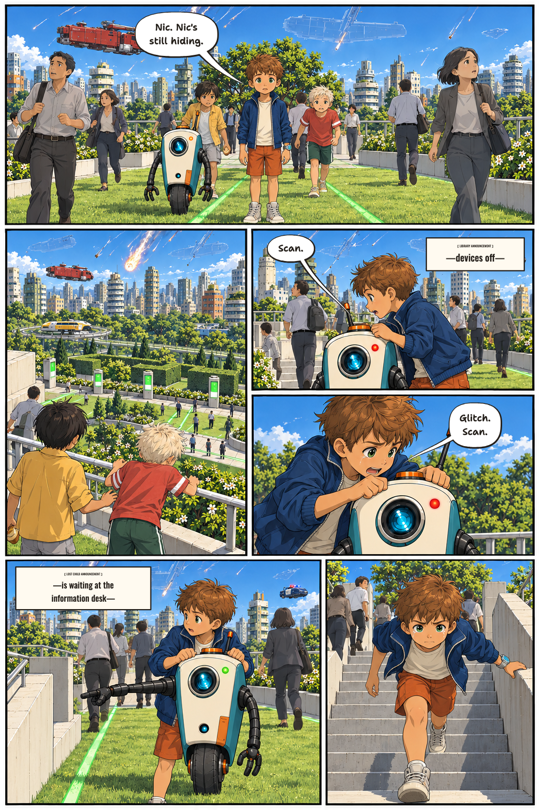
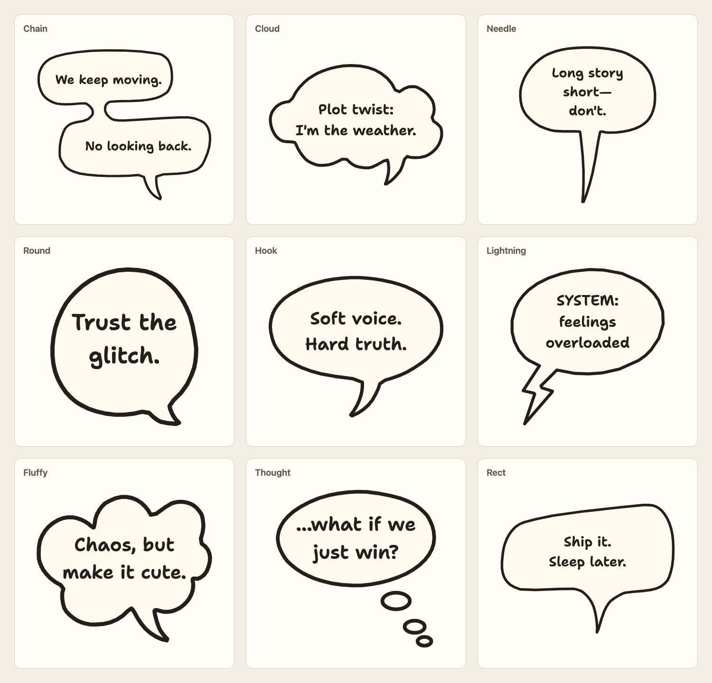
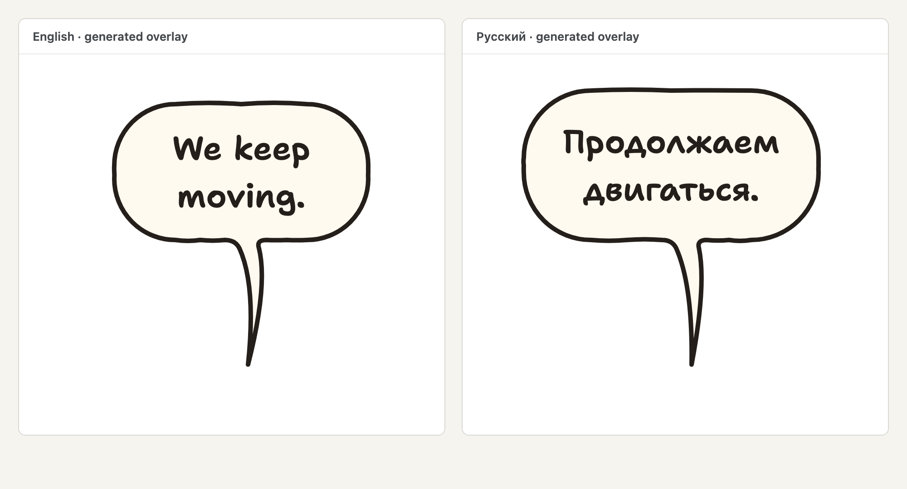

# wubble

**Letter a comic page in more than one language without changing the artwork.** Wubble takes a page manifest with dialogue, placements, and speaker anchors, then produces a transparent SVG lettering overlay for each requested locale.



_A draft lettering composite on page 11 of Rift City Comics, using its scripted dialogue and project configuration. Wubble rendered the SVG overlay; a browser composited it over the artwork. The placement is an example, not an approved final page._



_Nine balloon shapes rendered by Wubble. Each retains its shape and lettering as a transparent SVG overlay._



_English and Russian close-ups from the same bundled example. The white background is for viewing; the SVG overlays are transparent._

The dialogue and art remain yours: Wubble does not write or translate text, draw the underlying page, or automatically find the best positions. It handles the repeatable lettering work—measuring text against bundled fonts, drawing balloons and tails, and checking the manifest for problems before it renders.

## What it does

- **Separate language overlays:** keep dialogue IDs and speaker anchors consistent while changing the text, line breaks, or placement for each locale.
- **Measured lettering:** shape and measure text with bundled fonts, fit it within the specified bounds, and embed the fonts in the resulting SVG.
- **Balloons and styles:** choose from registered shapes, adjust outlines and tails, and use project-specific style and font settings without changing the renderer.
- **Actionable checks:** report issues such as missing translations or anchors, text overflow, and hard exclusion overlaps.
- **Repeatable output:** the same normalized inputs, renderer version, and font bytes produce the same SVG bytes.

A person or an LLM can author the manifest. Wubble validates and renders it; it does not call an LLM or image generator.

## Try the example

Requires [Bun](https://bun.sh/) **1.3 or newer**. From a checkout of this repository:

```sh
bun install --frozen-lockfile
mkdir -p out

# Validate the sample in each locale
bun run wubble validate examples/page-022.json --locale en
bun run wubble validate examples/page-022.json --locale ru

# Render page-sized transparent SVG overlays
bun run wubble render examples/page-022.json --locale en --output out/page-en.svg
bun run wubble render examples/page-022.json --locale ru --output out/page-ru.svg
```

The example contains an English and a Russian version of the same lettering. `out/` is ignored by Git. To composite an overlay over your own artwork as a PNG proof, use the `proof` command:

```sh
bun run wubble proof examples/page-022.json --locale en \
  --art path/to/artwork.png --output out/page-proof.png
```

Use artwork with the same proportions as the manifest's coordinate space; the proof command resizes the overlay to the supplied image. A proof is a review aid, not a replacement for the original artwork or a print-ready page. On some systems the PNG proof renderer may substitute fonts embedded in the SVG; compare the proof with the SVG in a browser before relying on its lettering.

## How it works

A manifest describes the page dimensions, subjects and named anchors, areas to avoid, balloon placements, and localized text. Wubble validates that input, measures the text, builds balloon and tail geometry, and serializes an SVG overlay for the requested locale. Diagnostics explain errors and warnings, and rendering is refused when error-level diagnostics are present.

The bundled profile provides neutral defaults. Supply a JSON configuration with `--config` to adjust a project's styles, typefaces, and rules. See [FORMAT.md](FORMAT.md) for the manifest, shape catalogue, configuration, and diagnostics, and [the schema](schemas/page.schema.json) for the machine-readable contract.

For programmatic use, the package exports `validatePage` and `renderPage`:

```ts
import { validatePage, renderPage } from "wubble";

const report = validatePage(manifest, { locale: "en", profileId: "wubble-default" });
const { svg, diagnostics } = renderPage(manifest, {
  locale: "ru",
  profileId: "wubble-default",
});
```

## Development

```sh
bun test       # tests
bun run check  # typecheck, lint, assertion scan, and formatting check
```

The bundled fonts and their SIL Open Font License notices are in [`assets/fonts/`](assets/fonts/). [`SPEC.md`](SPEC.md) records the initial proof contract; [`FORMAT.md`](FORMAT.md) describes the current format and behavior.
